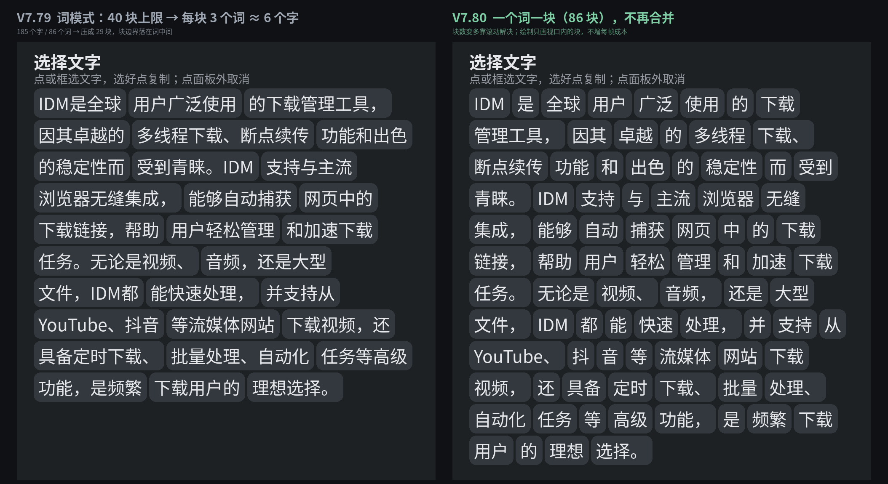

# V7.80 说明：「词」模式一个词一块

你截图里那块「IDM是全球用户 / 广泛使用的下载 / 管理工具，因其」——每块 4 个词、
7 个字左右，边界全落在词中间。这次修的就是它。

**不是 ICU 没分词，是我们自己把词又粘回去了。**

> 本文写于开发时。提到的 `build_v80.py` / `gen_import_v80.py` / `test_v80_*.js` 属于当时的本地工具链，未随仓库发布；发行文件见 `dist/v7.80/`，自检用 `python3 tools/verify_dist.py`。

---

## 一、根因

V7.37 加过一条「块数上限 40」：

```js
selectPanelMaxChips: 40,
...
if (sg.length > maxChips) {
  var mg = mergeSegments(sg, maxChips);   // 每 ceil(n/40) 个相邻词合成一块
}
```

ICU 给出的其实是正常的词（`IDM / 是 / 全球 / 用户 / 广泛 / 使用 / 的 / 下载 / …`），
这一步又把 **4 个相邻词粘成一块**。40 个块 = 每块 4 个词 ≈ 7 个字，
看上去就是「按字数硬截断」—— 你反馈的正是这个现象。

**复现**：拿同题材的一段文字（185 字 / 86 个词）跑同一套逻辑：
40 上限 → `ceil(86/40)=3` → 压成 29 块，每块 3 个词 ≈ 6 个字。
你截图里是每块 4 个词，对应原文约 160 个词，同一回事。

## 二、改了什么

| 改动 | 说明 |
|---|---|
| 删 `mergeSegments()` | 最后一个调用点就是词模式 |
| 删 `selectPanelMaxChips: 40` | 配置项只服务这一处 |
| 删 `PANEL_RECHUNK` 探针 | 合并没了，日志也没意义 |
| `buildAll()` 词模式 | ICU 切出多少块就排多少块 |
| 新增 `PANEL_SEG src=icu\|char chips=n` | 一眼看清走的是分词还是按字 |
| 新增单块 12 字上限 | 见下 |

**为什么现在可以不要上限**：V7.37 那会儿文字区不能滚，块多就要多画；
V7.46 改成滚动、V7.51 绘制按视口裁剪 + 行表二分，**块数已经不进每帧成本**了。
800 个词块实测排布 2ms（V8 模拟环境，真机因 `measureText` 走 JNI 会慢些，但仍是线性的）。
块变多的唯一代价是内容变长 —— 滚动解决。

**12 字上限**：ICU 词典缺失的 ROM 会把整句当成一个 span，那种块点一下就把整句选走，
比按字还难用。所以超长的先按标点切（切在「，。」之后），切完还长就等分；
正常分词每块 1~4 字，走不到这段，一个块都不会被动到。

## 三、效果



| | V7.79 | V7.80 |
|---|---|---|
| 185 字 / 86 个词 | 压成 29 块（每块 3 个词 ≈ 6 字） | **86 块，一块一个词** |
| 120 个词 | 压成 40 块 | **120 块** |
| 点击命中 | 选到的是「4 个词」 | 选到的是**一个词** |

代价很实在：块数变多，一屏看不完，要滚。但拖选仍然连续 —— 块表由 `layoutFor()`
一次排好，命中走行表二分，块多了只是行多了。

## 四、没动的

- 面板尺寸与字号：块 15sp / 25dp / 间距 2dp / 留白 8dp，按钮 12sp / 34dp
- 面板宽度、68% 屏高上限、缩略图、配色
- 命中判定、拖选、边缘自动滚、模式切换
- OCR、截图、分享链路，ShortX 4 分支、三条 shell（mv 137 / scan 175 / am 234）、吐司「正在分享」
- 交付 JSON 的 5 个字段

## 五、验证

| 项目 | 结果 |
|---|---|
| `test_v80_*.js` | **27 个文件 / 1211 项**全过 |
| 新增 `test_v80_words.js` | **19 项**：块数 = 词数、每块 = 一个词、点选复制单个词、120 词不合并、整句 span 被切、单字模式不受影响、800 块性能 |
| `verify_import_v80.py` | **86 项**通过（4 分支 / 三条命令逐字节 / 内嵌母版逐字节 / `versionCode 108`） |
| Rhino 1.7.14 实解析 | 母版 135ms、导入文件内嵌那份 105ms，`PARSE OK` |
| `versionCode` | 107 → **108** |

> **判别力**：把 `test_v80_words.js` 指回 V7.79（`SRC=.../V7.79_...js`），
> 3 项当场失败：120 个词被压成 40 块、没有 `PANEL_SEG` 探针、整句 span 不按标点切。

> **改了 4 个旧测试的断言**（都是断言「旧行为」的）：
> `flow` 的「块数上限 40」→「上限已删」；`panel` 的「超块数先合并」→「不再合并」；
> `seg` 的 merge 用例换成「源码里没有 mergeSegments」；`smoke` 的「120 字压到 ≤40 块」
> →「120 字 120 块」。断言方向反过来了，不是放宽。

## 六、仍然取决于设备的一点

最终「词」切得好不好，取决于设备自带的 ICU 中文词典 —— 那不在脚本里。
脚本能做的是：**ICU 切出来什么样，就按什么样排，不再二次篡改**。

如果哪天觉得某台机器切得不对，看日志里这行：

```
PANEL_SEG src=icu chips=86     ← 走的是 ICU 分词
PANEL_SEG src=char chips=185   ← ICU 不可用，退回了按字
```

`src=char` 就说明这台机器的词典没起来，那时才需要另做方案（内置词表）。

## 七、文件

| 文件 | 说明 |
|---|---|
| `dist/v7.80/屏幕取字_V7.80_ShortX导入.txt` | **导入这个**（`versionCode 108`，内嵌母版原文 379KB） |
| `dist/v7.80/screenpick_pointer_v7.80.js` | 母版（改代码改它） |
| `assets/v7.80-分词对比.png` | 同一段文字的「合并 / 不合并」对比 |
| `build_v80.py` / `gen_import_v80.py` / `verify_import_v80.py` | 生成 / 打包 / 校验 |

改完代码的固定顺序：

```bash
vim dist/v7.80/screenpick_pointer_v7.80.js
python3 gen_import_v80.py
python3 verify_import_v80.py
```
